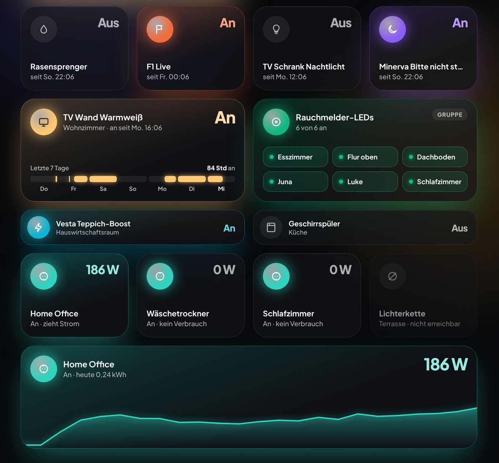
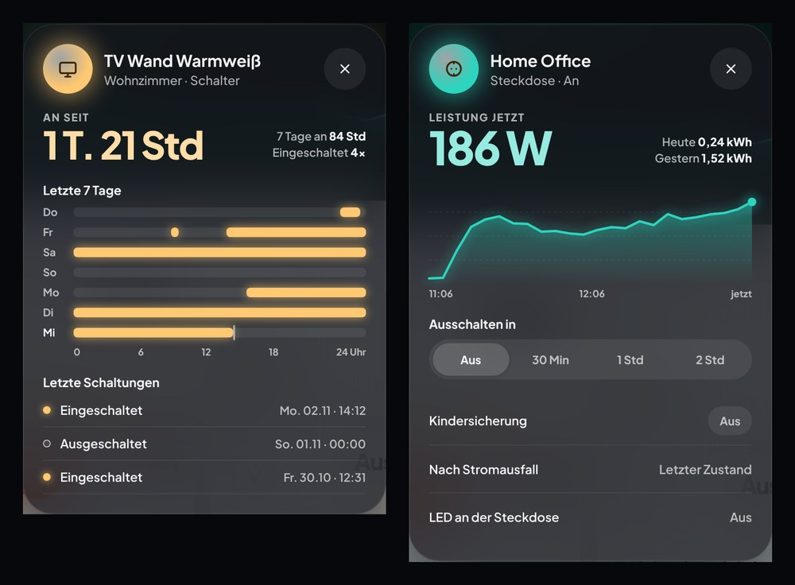
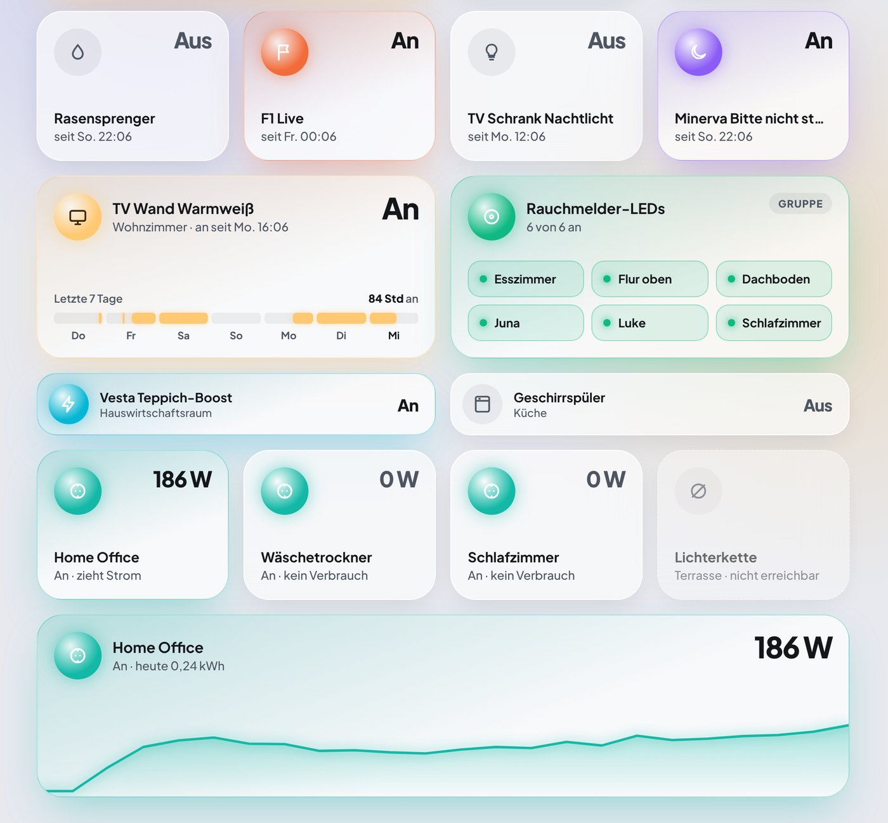

# GlowCard

[English](README.md) · **Deutsch**

[](https://hacs.xyz/docs/faq/custom_repositories/)


**GlowCard** ist ein Set eigener Dashboard-Karten für [Home Assistant](https://www.home-assistant.io/) mit einem einheitlichen Look: Milchglas, weiches farbiges Leuchten, heller und dunkler Modus und eigene Popups.







- Karten aus Milchglas; ein aktives Gerät färbt seine Karte ein und leuchtet in seiner eigenen Farbe.
- Runde „Orb“-Symbole: Tippen auf den Orb schaltet ein/aus. Keine extra Schalterzeilen.
- Werte wie Helligkeit stellt man ein, indem man den Balken selbst zieht.
- Lichter nutzen ihre **aktuelle** Farbe für Orb, Balken und Kartentönung.
- Eingebaute Popups (kein Bubble Card oder browser_mod nötig).
- Funktioniert **nur mit Standard-Entitäten von Home Assistant**. Keine Helfer, Template-Sensoren oder Automationen nötig.

> [!NOTE]
> GlowCard ist in der Beta. v0.1.0 enthält die Schalter- und die Steckdosen-Karte; weitere Karten folgen (siehe Roadmap). Optionen können sich bis v1.0 noch ändern.

## Karten

| Karte          | Typ                      | Entitäten                                           | Status           |
| -------------- | ------------------------ | --------------------------------------------------- | ---------------- |
| Schalter       | `custom:glowcard-switch` | `switch.*`, `input_boolean.*`                       | Beta (v0.1)      |
| Steckdose      | `custom:glowcard-plug`   | `switch.*` + optional Leistungs-/Energie-`sensor.*` | Beta (v0.1)      |
| Licht          | `custom:glowcard-light`  | `light.*`                                           | geplant für v0.2 |
| Kopfzeile      | `custom:glowcard-header` | `person.*`, Begrüßung, Datum/Uhrzeit                | geplant für v0.3 |
| Status-Leiste  | `custom:glowcard-status` | beliebige Entitäten, in Segmenten gruppiert         | geplant für v0.3 |
| Chip           | `custom:glowcard-chip`   | beliebige Entität                                   | geplant für v0.3 |
| Energie „Haus“ | `custom:glowcard-energy` | Leistungs-`sensor.*` für Solar, Akku, Netz, Haus    | geplant für v0.4 |

Visuelle Editoren für alle Karten sind für v1.0 geplant. Siehe [Roadmap](#roadmap).

## Installation

### HACS (empfohlen)

GlowCard ist noch nicht in der HACS-Standardliste. Füge es als benutzerdefiniertes Repository hinzu:

1. **HACS** in Home Assistant öffnen.
2. Menü (⋮, oben rechts) öffnen und **Benutzerdefinierte Repositories** wählen.
3. Repository: `https://github.com/JeeCay09/GlowCard`, Typ: **Dashboard**. Auf **Hinzufügen** klicken.
4. In HACS nach **GlowCard** suchen, öffnen und **Herunterladen** klicken.
5. Browser neu laden (Cache leeren, falls die Karten nicht erscheinen).

HACS trägt die Dashboard-Ressource automatisch ein. Wenn deine Dashboards im YAML-Modus laufen, trage sie selbst ein:

```yaml
lovelace:
  resources:
    - url: /hacsfiles/GlowCard/glowcard.js
      type: module
```

### Manuell

1. `glowcard.js` aus dem [neuesten Release](https://github.com/JeeCay09/GlowCard/releases/latest) herunterladen.
2. Nach `<config>/www/glowcard/glowcard.js` kopieren.
3. **Einstellungen → Dashboards → ⋮ → Ressourcen → Ressource hinzufügen**:
   - URL: `/local/glowcard/glowcard.js`
   - Typ: **JavaScript-Modul**
4. Browser neu laden.

Nach einem Update die URL z. B. auf `/local/glowcard/glowcard.js?v=0.1.0` ändern, damit Browser die neue Datei laden.

## Konfiguration

Alle Karten teilen diese Optionen:

| Option        | Typ    | Standard           | Beschreibung                                               |
| ------------- | ------ | ------------------ | ---------------------------------------------------------- |
| `entity`      | String | Pflicht            | Haupt-Entität der Karte                                    |
| `name`        | String | Anzeigename        | Titel auf der Karte                                        |
| `icon`        | String | Symbol der Entität | Beliebiges `mdi:`-Symbol                                   |
| `color`       | String | je Kartentyp       | Akzentfarbe (`amber`, `teal`, `sky`, `violet`, … oder Hex) |
| `variant`     | String | `small`            | Layout der Karte, abhängig vom Kartentyp                   |
| `tap_action`  | Aktion | Popup öffnen       | Standard-Aktion von Home Assistant                         |
| `hold_action` | Aktion | `more-info`        | Standard-Aktion von Home Assistant                         |

Die Beispiele zeigen die geplanten Optionen. Details können sich bis v1.0 noch ändern.

### Schalter

```yaml
type: custom:glowcard-switch
entity: switch.garden_sprinkler
name: Rasensprenger
color: sky
variant: wide # small | wide (7-Tage-Streifen) | row
```

Gruppe von Schaltern (der Orb schaltet alle):

```yaml
type: custom:glowcard-switch
name: Rauchmelder-LEDs
color: green
entities:
  - switch.smoke_detector_kitchen_led
  - switch.smoke_detector_hallway_led
  - switch.smoke_detector_bedroom_led
```

### Steckdose

```yaml
type: custom:glowcard-plug
entity: switch.office_plug
name: Home Office
variant: wide # small | wide (Live-Leistungskurve)
threshold: 1 # leuchtet ab so vielen Watt (Standard 1)
```

Die Karte findet Leistungs- und Energie-Sensor, Countdown, Kindersicherung sowie die Selects für „Nach Stromausfall“ und die LED selbst über das Gerät der Steckdose. Zeilen im Popup erscheinen nur, wenn die Steckdose die passende Entität hat. Falls die Erkennung danebenliegt, lassen sie sich festlegen: `power_entity`, `energy_entity`, `countdown_entity`, `child_lock_entity`, `power_on_entity`, `indicator_entity`.

### Licht

```yaml
type: custom:glowcard-light
entity: light.living_room_strip
name: TV-Wand
```

### Kopfzeile und Status-Leiste

```yaml
type: custom:glowcard-header
persons:
  - person.alex
  - person.sam
---
type: custom:glowcard-status
segments:
  - type: weather
    entity: weather.home
  - type: lights # zählt eingeschaltete Lichter, Popup listet sie
    entities: all
  - type: energy
    solar: sensor.pv_power
    battery: sensor.battery_state_of_charge
  - type: security
    entities:
      - binary_sensor.bathroom_window
      - binary_sensor.smoke_detectors
```

### Energie „Haus“

```yaml
type: custom:glowcard-energy
solar: sensor.pv_power
battery: sensor.battery_power # positiv = Laden
battery_soc: sensor.battery_state_of_charge
grid: sensor.grid_power # negativ = Einspeisung
home: sensor.home_load_power
```

## Roadmap

1. Kern: Glas, Orb, Ziehbalken, Popups, heller/dunkler Modus
2. Schalter- und Steckdosen-Karte → **v0.1.0 (Beta)**
3. Licht-Karte und Popup → v0.2.0
4. Kopfzeile, Status-Leiste und Chips → v0.3.0
5. Energie-Karte „Haus“ und Popup → v0.4.0
6. Visuelle Editoren, vollständige Doku, Antrag auf HACS-Standardliste → v1.0.0

Später: Raum-Karte, Binärsensor, Bewässerung/Pflanze, Popups für Medien, Rollos und Saugroboter.

## Entwicklung

```bash
npm install
npm run watch   # baut bei jeder Änderung neu
npm run dev     # baut inkl. Vorschauseite, dann: npm run serve → http://localhost:5050/dev/
npm test        # Unit-Tests
npm run build   # erzeugt dist/glowcard.js
```

Releases werden per GitHub Actions gebaut; `glowcard.js` wird an jedes GitHub-Release angehängt. Die HACS-Validierung läuft bei jedem Push.

## Lizenz

MIT. Die eingebettete Schrift [Plus Jakarta Sans](https://github.com/tokotype/PlusJakartaSans) steht unter der SIL Open Font License 1.1 (siehe `src/assets/OFL-PlusJakartaSans.txt`).
