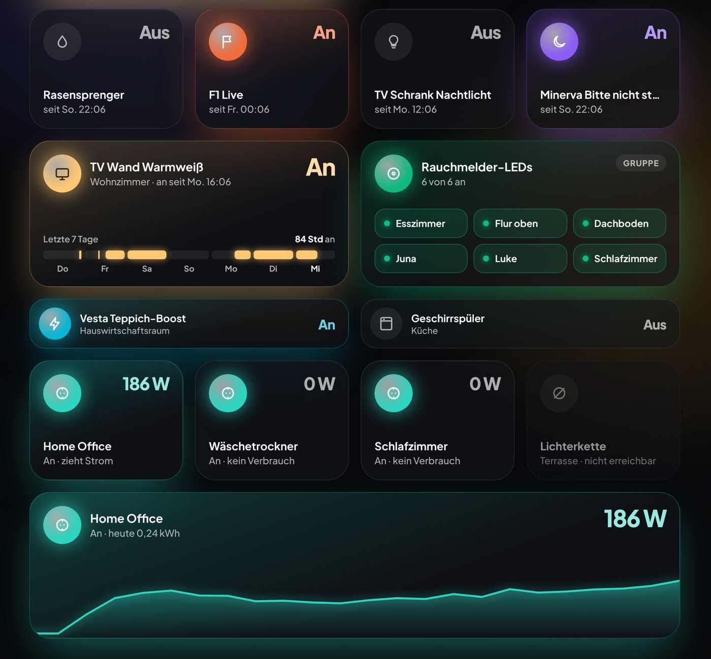
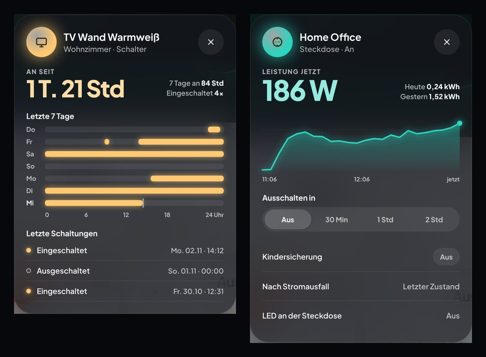
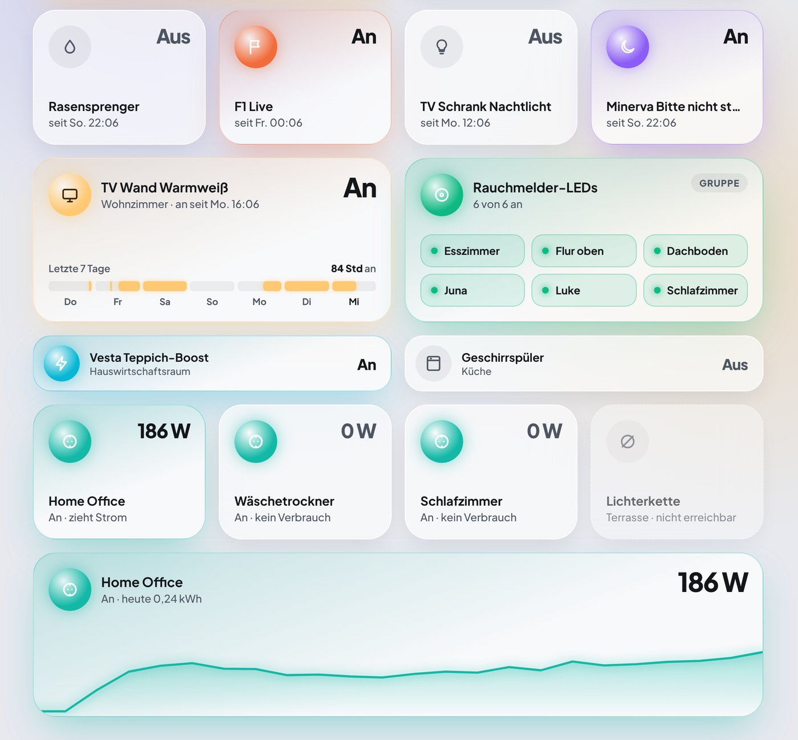

# GlowCard

**English** · [Deutsch](README.de.md)

[](https://hacs.xyz/docs/faq/custom_repositories/)


**GlowCard** is a set of custom dashboard cards for [Home Assistant](https://www.home-assistant.io/) with one consistent look: frosted glass, soft coloured glow, light and dark mode, and its own popups.







- Frosted glass cards; an active device tints its card and casts a soft glow in its own colour.
- Tap a card (orb included) to switch it on/off, hold it to open the GlowCard popup. No extra toggle rows.
- Values like brightness are set by dragging the bar itself.
- Lights use their **current** colour for orb, bar and tint.
- Built-in popups (no Bubble Card or browser_mod needed).
- Works with **standard Home Assistant entities only**. No helpers, template sensors or automations required.

> [!NOTE]
> GlowCard is in beta. v0.9.4 contains the switch, light, header, status bar, chip, heading, energy and navigation cards, all with a visual editor; more cards follow (see the roadmap). Options may still change before v1.0.

## Cards

| Card       | Type                      | Entities                                       | Status      |
| ---------- | ------------------------- | ---------------------------------------------- | ----------- |
| Switch     | `custom:glowcard-switch`  | `switch.*` (plugs too), `input_boolean.*`      | beta (v0.1) |
| Light      | `custom:glowcard-light`   | `light.*`                                      | beta (v0.2) |
| Header     | `custom:glowcard-header`  | `person.*`, greeting, date/time                | beta (v0.3) |
| Status bar | `custom:glowcard-status`  | weather, lights, energy, security, alerts      | beta (v0.3) |
| Chip       | `custom:glowcard-chip`    | like the status bar, plus people and battery   | beta (v0.3) |
| Heading    | `custom:glowcard-heading` | any entities as badges                         | beta (v0.4) |
| Energy     | `custom:glowcard-energy`  | house or grid power `sensor.*`; solar optional | beta (v0.7) |
| Navigation | `custom:glowcard-nav`     | views, popups (`#hash`); status dots optional  | beta (v0.9) |

All cards have a visual editor (Home Assistant 2025.1 or newer). In a sections dashboard, the cards fit Home Assistant's grid exactly (rows of 56 px): tile 2 rows on phones or 3 on desktop, switch group and power card 3, mini, status bar and chip 1 row. Width: tile, light, mini and switch group = 1/2 (tile and mini can shrink to 1/4), switch with power/usage, header, status bar, heading, energy and chip rows = full width (the energy card cannot be made narrower), single chip = 1/2, icon-only chip = 1/4. You can still change the width in the dashboard editor. New cards start without an entity; when you add a card "by entity", it uses the entity you picked.

In the editor, "Tap behaviour" offers toggle, GlowCard popup, more info, navigate, open URL, perform action or nothing for tap and hold, all in one list.

## Installation

### HACS (recommended)

GlowCard is not in the HACS default list yet. Add it as a custom repository:

1. Open **HACS** in Home Assistant.
2. Open the menu (⋮, top right) and choose **Custom repositories**.
3. Repository: `https://github.com/JeeCay09/GlowCard`, type: **Dashboard**. Click **Add**.
4. Search for **GlowCard** in HACS, open it and click **Download**.
5. Reload your browser (clear the cache if the cards do not show up).

HACS adds the dashboard resource automatically. If your dashboards are in YAML mode, add it yourself:

```yaml
lovelace:
  resources:
    - url: /hacsfiles/GlowCard/glowcard.js
      type: module
```

### Manual

1. Download `glowcard.js` from the [latest release](https://github.com/JeeCay09/GlowCard/releases/latest).
2. Copy it to `<config>/www/glowcard/glowcard.js`.
3. Go to **Settings → Dashboards → ⋮ → Resources → Add resource**:
   - URL: `/local/glowcard/glowcard.js`
   - Type: **JavaScript module**
4. Reload your browser.

After an update, change the URL to e.g. `/local/glowcard/glowcard.js?v=0.9.4` so browsers load the new file.

## Configuration

All cards share these options:

| Option        | Type   | Default       | Description                                                                                                                      |
| ------------- | ------ | ------------- | -------------------------------------------------------------------------------------------------------------------------------- |
| `entity`      | string | required      | Main entity of the card                                                                                                          |
| `name`        | string | friendly name | Title shown on the card                                                                                                          |
| `icon`        | string | entity icon   | Any `mdi:` icon                                                                                                                  |
| `color`       | string | per card type | Accent colour (`amber`, `teal`, `sky`, `violet`, … or hex)                                                                       |
| `size`        | string | `auto`        | Switch, light, status bar: `auto` (compact on phones under 600 px), `compact`, `normal`; switch and light also `mini` (one line) |
| `tap_action`  | action | `toggle`      | Home Assistant action, or `action: popup` for the GlowCard popup                                                                 |
| `hold_action` | action | `popup`       | Home Assistant action, or `action: popup` for the GlowCard popup                                                                 |

The examples below show the planned options. Details may still change before v1.0.

### Switch

```yaml
type: custom:glowcard-switch
entity: switch.garden_sprinkler
name: Sprinkler
color: sky
size: mini # auto | compact | normal | mini (one line, e.g. for lists)
```

The popup (hold) shows the 7-day history. The former `variant: wide` is shown as a tile, `variant: row` as `size: mini`.

Group of switches (tapping the card toggles all of them, holding does nothing by default):

```yaml
type: custom:glowcard-switch
name: Smoke detector LEDs
color: green
entities:
  - switch.smoke_detector_kitchen_led
  - switch.smoke_detector_hallway_led
  - switch.smoke_detector_bedroom_led
```

#### Smart plugs

Smart plugs use the same card. It finds the power and energy sensors, countdown, child lock, "power on behaviour" and indicator selects on the same device by itself. They appear in the popup as soon as the device has that entity. On the card, watts, curve and usage only show with `show_power: true`.

```yaml
type: custom:glowcard-switch
entity: switch.office_plug
name: Home office
show_power: true # watts, live curve and today's usage on the card, full width (default false)
threshold: 1 # with show_power: glows from this many watts (default 1)
```

With `size: mini` and `show_power`, the row shows the watts instead of on/off. If detection picks the wrong entity, set it yourself: `power_entity`, `energy_entity`, `countdown_entity`, `child_lock_entity`, `power_on_entity`, `indicator_entity`.

The former `custom:glowcard-plug` card is gone. For existing cards, change the type to `custom:glowcard-switch` and replace `variant: wide` with `show_power: true`.

### Light

```yaml
type: custom:glowcard-light
entity: light.living_room
```

Orb, bar and tint use the light's current colour. Drag the bar to set the brightness; dragging to 0 turns the light off. The card is always 2 columns wide (the former `variant: small` is shown wide). Top right it shows the brightness while the light is on; lights without dimming show nothing there. The popup has a tall brightness bar (lights without dimming get a big on/off switch instead), tabs for colour temperature and colour (only what the light supports, from `supported_color_modes`) and colour presets from warm white to blue.

### Header

```yaml
type: custom:glowcard-header
persons:
  - person.alex
  - person.sam
name: Alex # optional, default: first name of the signed-in user
```

Greeting by time of day ("Good morning, Alex"), date and time, people on the right. Whoever is at home gets a green ring. Tap a person to open their details. Use `greeting:` for your own text.

### Status bar

One glass capsule with segments. Segments with an arrow open a popup; the tapped segment gets a coloured ring.

Simple (this is also what the visual editor saves; order as in the screenshot):

```yaml
type: custom:glowcard-status
weather: weather.home
all_lights: true # or lights: [light.a, light.b]
exclude_lights: # optional, only with all_lights
  - light.night_light
solar: sensor.pv_power
battery: sensor.battery_level # state of charge in %
battery_power: sensor.battery_power # + = charging
grid: sensor.grid_power # + = import, − = export
home: sensor.home_power
security:
  - binary_sensor.bathroom_window
  - binary_sensor.smoke_detectors
alerts:
  - binary_sensor.vacuum_problem # only shown while there is a problem
```

Free (YAML only), with your own order, names and actions:

```yaml
type: custom:glowcard-status
segments:
  - type: weather
    entity: weather.home
    tap_action:
      action: none # no arrow, not tappable
  - type: lights # without entities: all lights (light groups are skipped)
    exclude: [light.night_light] # optional
  - type: energy
    solar: sensor.pv_power
    battery: sensor.battery_level
    battery_power: sensor.battery_power
    navigation_path: /energy # target of "Open energy flow"
  - type: security
    entities:
      - entity: binary_sensor.bathroom_window
        name: Bathroom window
      - binary_sensor.smoke_detectors
  - type: alert
    entity: binary_sensor.vacuum_problem
```

| Segment    | Shows                                    | Popup                                                             |
| ---------- | ---------------------------------------- | ----------------------------------------------------------------- |
| `weather`  | temperature, condition, humidity         | – (default: weather details)                                      |
| `lights`   | number of lights that are on             | "Lights on": orb toggles, drag the bar, "Turn all off"            |
| `energy`   | solar power, battery level and direction | "Energy now": solar, house, battery, grid                         |
| `battery`  | battery with a ring (mainly as a chip)   | same as `energy`                                                  |
| `security` | "All secure" or the number of alerts     | list with state and "since …"; tap a row for details              |
| `alert`    | device and error text, red with a pulse  | error and since when; for robot vacuums "Resume"/"Return to base" |
| `person`   | avatar and location                      | – (person details)                                                |
| `entity`   | any entity with its state                | – (entity details)                                                |

Security counts `binary_sensor` that are `on` (open, smoke, …), unlocked `lock`, triggered `alarm_control_panel` and open `cover` as an alert. For `alert`, the card finds the error text (`sensor.*_error`) and the robot vacuum (`vacuum.*`) on the same device by itself; otherwise set `detail_entity` and `vacuum`. Every segment accepts `name`, `icon`, `color`, `tap_action` and `hold_action`.

On narrow screens the bar scrolls sideways; the icon-only chips are the compact option there.

### Chips

One chip per card (visual editor) or a row with `chips:` (YAML). Entries are the same as in the status bar and open the same popups.

```yaml
type: custom:glowcard-chip
chip: lights
---
type: custom:glowcard-chip
chips:
  - type: weather
    entity: weather.home
  - type: lights
  - type: person
    entity: person.alex
  - type: battery
    battery: sensor.battery_level
    battery_power: sensor.battery_power
  - type: security
    entities: [binary_sensor.bathroom_window]
  - type: alert
    entity: binary_sensor.vacuum_problem
---
type: custom:glowcard-chip
icon_only: true # round icons with count badges, e.g. for phones
chips:
  - type: lights
  - type: alert
    entity: binary_sensor.vacuum_problem
```

Unavailable entities are shown dashed and faded. An alert chip without a problem disappears (`hide_when_ok: false` shows it in green).

### Heading

A section title with a round icon, a line below and small glass badges, or a small caps subtitle to group sections. The icon stays neutral by default. With `glow_color` ("Colour" picker in the editor) it is shown in that colour, also without glow. With `glow_entity` it glows while that entity is on, in `glow_color` or else the light's own colour.

```yaml
type: custom:glowcard-heading
heading: Living room
subtitle: Ground floor
icon: mdi:sofa-outline
badges:
  - sensor.living_room_temperature
  - sensor.living_room_humidity
  - sensor.living_room_sensor_battery # red and pulsing at 15 % or less
  - type: lights # YAML: same entries as the status bar, opens the lights popup
    entities: [light.tv_wall]
glow_entity: light.living_room # optional
glow_color: [255, 165, 110] # optional
tap_action: # optional, shows an arrow next to the title
  action: navigate
  navigation_path: /dashboard-home/living
---
type: custom:glowcard-heading
heading_style: subtitle
heading: Ground floor
subtitle: 6 rooms
```

### Energy

For every home, with or without solar: how much the house draws right now, and whether that is usual for this time of day. The card shows the current consumption as a big number with the usual range for this hour below it (the middle 60 % of the last 14 days at this hour). Above that range the number turns orange. Usual range and base load come from Home Assistant's long-term statistics, so the sensor needs a `state_class` (all power sensors of common integrations have one). Status: "normal", "high" or "low".

One sensor is enough: the house consumption (`home`) or the grid power (`grid`, positive = import). Everything else is optional and extends the same card:

- `devices`: up to 5 power sensors. The card lists them by power; the rest of the house is shown as "Not measured".
- `solar`, `battery` (state of charge) and `battery_power` (positive = charging): the card grows by one row and shows tiles for solar, battery and grid. Without a house sensor the house is calculated from grid, solar and battery.
- `invert_grid` / `invert_battery`: for sensors with the opposite sign (export or discharging positive).

**Energy dashboard:** kWh today (usage, solar, import, export), the comparison with yesterday and the costs come from Home Assistant's energy dashboard without any setting. Costs use HA's cost statistics, so dynamic prices (e.g. Tibber or Nordpool) are billed correctly per hour. In "Advanced" you can override this with daily meters (`energy_today`, `solar_energy`, `grid_import_energy`, `grid_export_energy`), a `price` (sensor or number), a `fixed_price` or a `cost_today` sensor.

Tap opens the popup (consumption now, usual range, source, base load with cost per day, devices with share, today's curve against yesterday and the usual band, comparison tiles). Hold opens more info of the house sensor.

```yaml
type: custom:glowcard-energy
home: sensor.house_power # or grid: sensor.grid_power
devices: # optional
  - sensor.heat_pump_power
  - entity: sensor.tv_plug_power
    name: TV
# optional, with solar / battery:
solar: sensor.pv_power
battery: sensor.battery_state_of_charge
battery_power: sensor.battery_power # positive = charging
# invert_battery: true # if the sensor reports discharging as positive
# optional overrides (otherwise from the energy dashboard):
# energy_today: sensor.house_energy_today
# price: 0.32
```

### Navigation

A bar of round icon buttons to switch views or open popups (e.g. Bubble Card popups via `#hash`), as one frosted glass capsule. The button of the current view is a lit orb in a soft marker. On a change the buttons stay in place: the marker glides to the new button and only then its orb lights up.

- `position: float` (default): the bar floats at the bottom of the screen, cards scroll underneath. While you edit the dashboard (and in the editor preview) it sits inline so you can still select it. Put it at the end of a view.
- `position: card`: a normal full-width card in the grid that scrolls with the page, e.g. for tablets.
- The current button is found from the address: a view path (`/dashboard/view`, or just `view`) or an open popup `#hash`. A button for the dashboard itself (`/dashboard`) is marked on its first view (`/dashboard/0`).
- Put the same bar (same icons in the same order) into every view: after a view change the marker glides on from the old button, as if it were one bar.
- `entity` (optional, per button): a small dot shows while it is on (light on, vacuum cleaning, media playing …); lights use their own colour.
- `color`: glow colour of the current button (accent name such as `indigo`, `blue`, `green`, `red`, `pink`, `purple`, or hex; default indigo); a button's own `color` wins, so each button can have its own.
- Per button `tap_action` / `hold_action` (YAML) run any Home Assistant action instead of navigating.

```yaml
type: custom:glowcard-nav
position: float # or card
buttons:
  - icon: mdi:home-outline
    name: Start
    navigation_path: /dashboard-home/start
  - icon: mdi:sofa-outline
    name: Living room
    navigation_path: '#living' # opens a popup
    entity: light.living_room # optional status dot
  - icon: mdi:robot-vacuum
    name: Vacuum
    navigation_path: '#vacuum'
    entity: vacuum.vesta
    color: green # optional, per button
  - icon: mdi:heart-pulse
    name: System
    tap_action:
      action: more-info
      entity: sensor.system_health
```

## Roadmap

1. Core: glass, orb, drag bar, popups, light/dark mode
2. Switch and plug cards → v0.1.0 (beta)
3. Light card and popup → v0.2.0 (beta)
4. Header, status bar and chips, visual editor and default widths → **v0.3.0 (beta)**
5. Heading card (section titles with badges, added to the plan) → v0.4.0; Energy card "load ring" with popup → v0.7.0; energy card without ring (big current value), editor and phone layout → v0.8.0; navigation bar (floating or as a card) → v0.9.0
6. Visual editors for all cards, full docs, submission to the HACS default list → v1.0.0

Later: room card, binary sensor, irrigation/plant, media, cover and vacuum popups.

## Development

```bash
npm install
npm run watch   # rebuild on every change
npm run dev     # rebuild incl. the preview page, then: npm run serve → http://localhost:5050/dev/
npm test        # unit tests
npm run build   # creates dist/glowcard.js
```

Releases are built by GitHub Actions; `glowcard.js` is attached to each GitHub release. The HACS validation action runs on every push.

## License

MIT. The embedded font [Plus Jakarta Sans](https://github.com/tokotype/PlusJakartaSans) is licensed under the SIL Open Font License 1.1 (see `src/assets/OFL-PlusJakartaSans.txt`).
